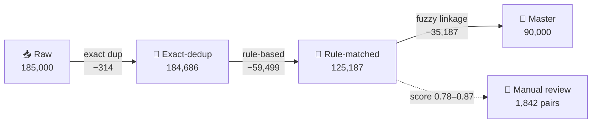

# 🔗 Customer Data Deduplication & Record Linkage Pipeline


> Merges two customer systems (**CRM** and **BILLING**) into one trusted customer master: exact duplicates are dropped, near-duplicates are linked, and ambiguous cases are routed to a human instead of being merged blindly.

**Audience:** business/data teams who want to know *what changed in the data*, and external technical reviewers who want to know *how and why*.

---

## 📌 TL;DR

| | |
|---|---|
| **Input** | 185,000 records (CRM: 100,000 · BILLING: 85,000) |
| **Output** | 90,000 unique customers in `data/nc_cleaned_customers.csv` |
| **Records removed** | 95,000 (51.4%) |
| **Needs a human** | 1,842 ambiguous pairs → `output/duplicate_pairs_review.csv` |
| **Never merged silently** | Pairs with similarity score between 0.78 and 0.87 |

---

## 📑 Table of Contents

1. [Project Overview & Folder Structure](#1-project-overview--folder-structure)
2. [Dataset Schema](#2-dataset-schema)
3. [Deduplication Impact](#3-deduplication-impact)
4. [Pipeline Logic (Code Walkthrough)](#4-pipeline-logic-code-walkthrough)
5. [Statistical Diagnostics](#5-statistical-diagnostics)
6. [Data Quality Observations](#6-data-quality-observations)
7. [Evaluation & Limitations](#7-evaluation--limitations)
8. [How This Helps Business Users](#8-how-this-helps-business-users)
9. [Run It Yourself](#9-run-it-yourself)

---

## 1. Project Overview & Folder Structure

The pipeline takes two customer datasets, **CRM** and **BILLING**, cleans them, removes duplicates, and links records that refer to the same real person (for example `Roxsee Stover` in CRM and `Stover, Roxsee` in BILLING).

```text
.
├── README.md                                # This document
├── notebooks/
│   ├── 01_customer_dedup_eda.ipynb          # Exploratory analysis & statistical diagnostics
│   └── 02_customer_dedup_pipeline.ipynb     # Full deduplication & linkage pipeline
├── data/
│   ├── nc_merged_customers.csv              # Raw merged input (CRM + BILLING)
│   └── nc_cleaned_customers.csv             # Deduplicated master dataset
└── output/
    ├── duplicate_pairs_review.csv           # Fuzzy-matched pairs awaiting manual review
    └── metrics_summary.json                 # Data-quality and cluster metrics
```

---

## 2. Dataset Schema

| Field | Source | Type | Description | Handling |
| :--- | :---: | :---: | :--- | :--- |
| `record_id` | Both | `str` | Primary key of the raw record (e.g. `CRM0000001`, `BIL0018302`) | Kept as row identifier |
| `source_system` | Both | `str` | `CRM` or `BILLING` | Used to split source-specific features |
| `full_name` | Both | `str` | Customer name | Lowercased, punctuation removed |
| `email` | Both | `str` | Primary email | Standardized; missing flagged as `has_email` |
| `phone` | Both | `str` | Contact number | Digits extracted; missing flagged as `has_phone` |
| `address` | Both | `str` | Street address | Abbreviations standardized (`Rd` → `Road`) |
| `city` | Both | `str` | City (13 unique in NC) | Used for blocking |
| `state` | Both | `str` | State code (always `NC`) | Constant |
| `zip_code` | Both | `str` | Postal code | Stored as string to keep leading zeros |
| `created_date` | CRM | `datetime` | CRM registration date | Used to derive `tenure_years` |
| `customer_status` | CRM | `str` | `Active` / `Inactive` | Null for BILLING rows |
| `invoice_count` | BILLING | `float` | Total invoices generated | Null for CRM rows |
| `total_billed` | BILLING | `float` | Total billed amount ($) | Used for `avg_invoice` |
| `last_invoice_date` | BILLING | `datetime` | Date of latest invoice | Used for `days_since_last` |
| `payment_method` | BILLING | `str` | e.g. Credit Card | Null for CRM rows |
| `true_customer_id` | Both | `str` | Ground-truth entity ID (e.g. `CUST000008`) | Used **only for evaluation**, not as a matching input |

---

## 3. Deduplication Impact



| Stage | Records after | Removed at this stage | Cumulative removed | What happens |
| :--- | ---: | ---: | ---: | :--- |
| **Raw input** | 185,000 | — | 0 | CRM + BILLING combined |
| **Exact duplicates** | 184,686 | 314 | 314 | Rows identical on every column except `record_id` |
| **Rule-based match** | 125,187 | 59,499 | 59,813 | Same `full_name + email`, or same `full_name + address + zip_code` |
| **Fuzzy linkage** | 90,000 | 35,187 | 95,000 | Jaro-Winkler / Levenshtein on name and address across systems |
| **Manual review** | 90,000 | — | — | **1,842 pairs** with similarity 0.78–0.87 exported for a human decision |

> ⚠️ **Open item for the authors:** state explicitly whether the 1,842 review pairs are *already merged* in the 90,000 count or *kept separate* pending review, and list the exact auto-merge threshold (`[TODO: e.g. ≥ 0.88]`).

---

## 4. Pipeline Logic (Code Walkthrough)

### Step 1: Setup & Load

```python
import pandas as pd, numpy as np
import matplotlib.pyplot as plt, seaborn as sns
import warnings

warnings.filterwarnings("ignore")
sns.set_theme(style="whitegrid")

NOW = pd.Timestamp("2026-10-18")   # Fixed reference date for reproducible tenure/recency

df = pd.read_csv("data/nc_merged_customers.csv", low_memory=False)
print(f"Loaded shape: {df.shape}")
```

### Step 2: Exact & Rule-Based Duplicate Detection

```python
cols_without_id = [c for c in df.columns if c != "record_id"]
exact_dups = df.duplicated(subset=cols_without_id).sum()

dup_name_email = df.dropna(subset=["email"]).duplicated(subset=["full_name", "email"]).sum()
dup_name_addr  = df.dropna(subset=["address"]).duplicated(subset=["full_name", "zip_code", "address"]).sum()

df_cleaned = df.drop_duplicates(subset=cols_without_id).copy()
```

### Step 3: Missing-Value Flags

Contact fields are **flagged, not imputed**, because inventing an email or phone number would corrupt the master data.

```python
df_cleaned["has_email"]   = df_cleaned["email"].notna().astype(int)
df_cleaned["has_phone"]   = df_cleaned["phone"].notna().astype(int)
df_cleaned["has_address"] = df_cleaned["address"].notna().astype(int)
df_cleaned["n_missing_contact"] = df_cleaned[["email", "phone", "address"]].isna().sum(axis=1)
```

### Step 4: Feature Engineering

```python
bil = df_cleaned["source_system"] == "BILLING"
df_cleaned.loc[bil, "avg_invoice"]     = df_cleaned.loc[bil, "total_billed"] / df_cleaned.loc[bil, "invoice_count"]
df_cleaned.loc[bil, "days_since_last"] = (NOW - pd.to_datetime(df_cleaned.loc[bil, "last_invoice_date"])).dt.days

crm = df_cleaned["source_system"] == "CRM"
df_cleaned.loc[crm, "tenure_years"] = (NOW - pd.to_datetime(df_cleaned.loc[crm, "created_date"])).dt.days / 365.25

cluster_sizes = df_cleaned["true_customer_id"].value_counts()
df_cleaned["cluster_size"] = df_cleaned["true_customer_id"].map(cluster_sizes)
```

### Step 5: Statistical Diagnostics

```python
def generate_statistical_diagnostics(d, cols):
    """Mean, median, std, variance, CV%, skew, excess kurtosis, min, max."""
    return pd.DataFrame({
        "n": d[cols].count(), "mean": d[cols].mean(), "median": d[cols].median(),
        "std": d[cols].std(), "variance": d[cols].var(),
        "CV%": d[cols].std() / d[cols].mean() * 100,
        "skew": d[cols].skew(), "excess_kurt": d[cols].kurt(),
        "min": d[cols].min(), "max": d[cols].max(),
    }).round(3)
```

<details>
<summary>📎 <b>Fuzzy linkage code</b> (add from your pipeline notebook)</summary>

The rule-based and fuzzy stages in the impact table are not shown above. Paste the blocking, similarity scoring, and threshold logic here so a reviewer can reproduce the 125,187 → 90,000 step.

</details>

---

## 5. Statistical Diagnostics

| System | Feature | Mean | Median | Std | CV% | Skew | Excess Kurt. | Min | Max |
| :--- | :--- | ---: | ---: | ---: | ---: | ---: | ---: | ---: | ---: |
| BILLING | `invoice_count` | 30.51 | 31.00 | 17.34 | 56.8 | −0.001 | −1.209 | 1 | 60 |
| BILLING | `total_billed` | $12,582.47 | $12,570.66 | $7,183.61 | 57.1 | −0.006 | −1.196 | $50.27 | $24,998.40 |
| BILLING | `avg_invoice` | $975.80 | $411.76 | $2,154.68 | 220.8 | **6.283** | **49.277** | $0.89 | $24,990.32 |
| BILLING | `days_since_last` | 216.77 | 217.00 | 115.83 | 53.4 | −0.002 | −1.201 | 17 | 417 |
| CRM | `tenure_years` | 14.05 | 7.98 | 14.29 | 101.7 | **1.377** | **1.182** | 0.03 | 80.00 |

---

## 6. Data Quality Observations

1. **`avg_invoice` is extremely right-skewed** (skew 6.3, kurtosis 49.3). Customers with very few invoices have an average equal to one large bill. Use the **median ($411.76)**, or a log transform, for reporting and modeling.
2. **`tenure_years` reaches 80 years.** This is implausible for a customer relationship and likely comes from default or placeholder `created_date` values. Recommended: cap or flag dates before a sensible cutoff.
3. **Near-zero skew and excess kurtosis ≈ −1.2** on `invoice_count`, `total_billed`, and `days_since_last` are the signature of **uniform distributions**, which real-world billing data rarely shows. If this dataset is synthetic, say so here.
4. **`last_invoice_date` is typed `float` in the original schema.** It should be a date; it is converted with `pd.to_datetime` before use.

---

## 7. Evaluation & Limitations

Because `true_customer_id` is available, linkage quality can be measured directly. **Fill in from the notebook:**

| Metric | Value |
| :--- | :--- |
| Pairwise precision (merged pairs that are truly the same customer) | `[TODO]` |
| Pairwise recall (true duplicate pairs that were found) | `[TODO]` |
| F1 | `[TODO]` |
| False merges (different customers wrongly combined) | `[TODO]` |
| Review-queue size / share of all candidate pairs | 1,842 / `[TODO]` |

**Known limitations**

- Reaching exactly 90,000 entities equals the ground-truth count; reviewers will want precision/recall to confirm this is not coincidence or leakage.
- Contact-field consolidation (using a BILLING phone number for a CRM record) needs an explicit *survivorship rule* (which source wins on conflict). Document it before claiming automatic recovery.
- The data holds personal information (names, emails, phones, addresses). Do not commit real customer files to a public repository; use synthetic or masked data for sharing.

---

## 8. How This Helps Business Users

1. **Unified customer view:** one `true_customer_id` per person, even when CRM and BILLING spell the name or address differently.
2. **Complete contact details:** gaps in one system can be filled from the other once a survivorship rule is defined.
3. **Single-row profile:** lifespan (`tenure_years`), spend (`total_billed`), and inactivity risk (`days_since_last`) side by side.
4. **Safe review queue:** low-confidence matches go to `duplicate_pairs_review.csv` for a human decision, so the master data is never corrupted by a bad auto-merge.

---

## 9. Run It Yourself

```bash
git clone https://github.com/<your-username>/customer-dedup-record-linkage.git
cd customer-dedup-record-linkage
pip install pandas numpy scipy matplotlib seaborn scikit-learn jupyter
```

1. Open `notebooks/02_customer_dedup_pipeline.ipynb` in Google Colab, VS Code, or Jupyter and run all cells.
2. Check `data/nc_cleaned_customers.csv` for the master dataset.
3. Check `output/duplicate_pairs_review.csv` for pairs awaiting manual review, and `output/metrics_summary.json` for summary metrics.

---

<sub>Maintainers: update the `[TODO]` fields above before sharing with external reviewers.</sub>
